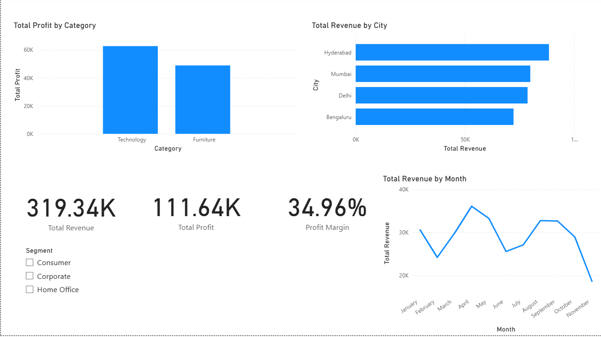

# E-Commerce Sales & Customer Insights Dashboard

An end-to-end analytics project using a relational SQL database (SQLite) and Power BI to analyze sales, profit, customer purchase behavior and regional performance.

## 📊 Project Overview
This project contains a star-schema database for a sample e-commerce business. I wrote SQL queries to analyze it, built the relational model in Power BI, created DAX measures, and designed a dashboard with the key business metrics.

## 🖼️ Dashboard

The dashboard includes:
* KPI cards: Total Revenue, Total Profit, Profit Margin %
* Total Profit by Category
* Total Revenue by City
* Total Revenue by Month (trend)
* Customer Segment slicer

The Power BI file is included: `ecommerce-dashboard.pbix`

## 🗄️ Database Schema & Star Schema
The project uses a **Star Schema**:
* **Fact Table:** `Orders` (OrderID, OrderDate, CustomerID, ProductID, RegionID, Quantity, Discount)
* **Dimension Tables:**
  * `Customers` (CustomerID, CustomerName, Email, Segment, JoinDate)
  * `Products` (ProductID, ProductName, Category, SubCategory, UnitPrice, UnitCost)
  * `Regions` (RegionID, City, State, Country)

## 📈 Power BI Measures (DAX)
* **Total Revenue:**
  `Total Revenue = SUMX(Orders, Orders[Quantity] * RELATED(Products[UnitPrice]) * (1 - Orders[Discount]))`
* **Total Profit:**
  `Total Profit = [Total Revenue] - SUMX(Orders, Orders[Quantity] * RELATED(Products[UnitCost]))`
* **Profit Margin (%):**
  `Profit Margin = DIVIDE([Total Profit], [Total Revenue], 0)`

## 🔍 SQL Analysis (`queries.sql`)
1. Revenue and profit margin by product category
2. Customer recency / frequency / monetary (RFM) metrics
3. Regional sales performance

## ⚠️ Data Note
The data is **synthetic**, created for learning and portfolio purposes. `schema.sql` creates the tables and loads a small starter dataset. `generate_sample_orders.sql` adds 500 randomly generated orders, giving **510 orders** in total (the file `ecommerce.db` contains the full dataset). Figures on the dashboard do not represent a real business.

## ⚙️ How to Set Up
1. **Database:** Open `ecommerce.db` in DB Browser for SQLite (it has the full 510-order dataset). To rebuild it from scratch, run `schema.sql`, then `generate_sample_orders.sql`.
2. **Queries:** Run the queries in `queries.sql` to see the raw analysis.
3. **Power BI:** Open `ecommerce-dashboard.pbix` in Power BI Desktop, or load the tables (exported as CSV) into a new report. Set relationships as one-to-many from each dimension to `Orders`, then add the DAX measures above.
